# Ampli World

A tiny town where an AI character lives its own life. **Ampli**, a small fox, gets hungry, tired, bored and lonely, decides for itself what to do about it, reads books, looks things up on the web, paints, chats with the neighbours and writes a diary every night. You watch, and you can see exactly how every thought was made.

It's a door-opener: people get used to AI by watching an agent behave instead of being asked to prompt one. Inspired by [Pino](https://pinos.world/).

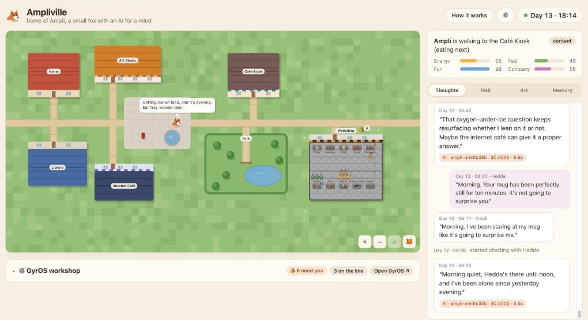

- [What you're looking at](#what-youre-looking-at)
- [Set it up on your Mac](#set-it-up-on-your-mac)
- [Everyday use](#everyday-use) · [If something's off](#if-somethings-off)
- [The animals](#the-animals) · [Personalities](#personalities) · [Neighbours](#neighbours) · [The library](#the-library)
- [GyrOS workshop (optional)](#gyros-workshop-optional)
- [For developers](#for-developers)

## What you're looking at

- **The town** (left): home, art studio, café, plaza with the notice board, park, library, internet café and the workshop. Your character walks the streets on its own. Hover over a building to look inside. Scroll to zoom, drag to move around, 🦊 follows your character.
- **Its state** (top right): what it's doing, its mood, and four needs that slowly drain: energy, food, fun and company. It decides what to do about them; nobody tells it.
- **Thoughts**: every decision comes with a thought in plain words, plus which model made it, how long it took and what it cost. Chats with neighbours, web searches with their sources, paintings and letters show up here too.
- **Mail**: write to your character (with a doodle if you like). It reads its post box in its own time and answers.
- **Art**: paintings it made in the studio, as SVG code it wrote itself.
- **Memory**: its notebook (the only long-term memory, rewritten every night) and its diary.
- **How it works**: the whole mechanism explained, with today's costs.

## Set it up on your Mac

No programming needed. Takes about 15 minutes, most of it waiting for downloads.

**You need** a Mac (Apple silicon or Intel) with an internet connection, and one of these for the thinking:
- **on your Mac**: 16 GB memory or more and about 10 GB free disk space (30 GB with 40 GB+ memory, for a faster model), free; or
- **in the cloud**: an [OpenRouter key](https://openrouter.ai/keys), about $2–3 a month.

### 1. Download

On the [GitHub page](https://github.com/DennisMuellerAM/ampliworld) click **Code → Download ZIP**, then double-click the ZIP to unpack it. Move the folder wherever you like, e.g. into Documents.

### 2. Start

Double-click **`Ampli World.command`** in the folder.

The very first time, macOS says it can't check the developer. That's expected for an internal tool: **right-click the file → Open → Open** (or System Settings → Privacy & Security → *Open Anyway*). You only do this once.

A Terminal window opens. The first start downloads Node.js (only if your Mac doesn't have it; the official version, checked against its checksum, kept inside the folder) and the app's parts, and builds the town. That takes a few minutes. Then your browser opens **http://localhost:4300** with the setup wizard.

### 3. The setup wizard

**Who lives here?** Pick one of eight animals (more about them [below](#the-animals)), give it a name, describe its species in your own words ("small fox", "very old cat") and name the town.

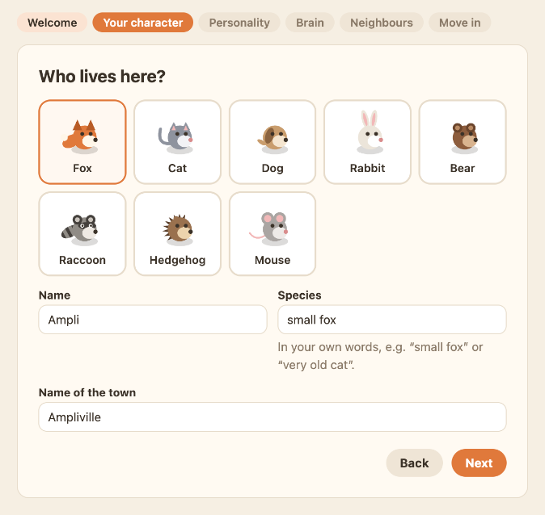

**What is it like?** Pick a [personality template](#personalities) and change whatever you like. The text is the character's system prompt: describe it the way you'd describe someone to an actor. Everything it does comes from this text and its needs.

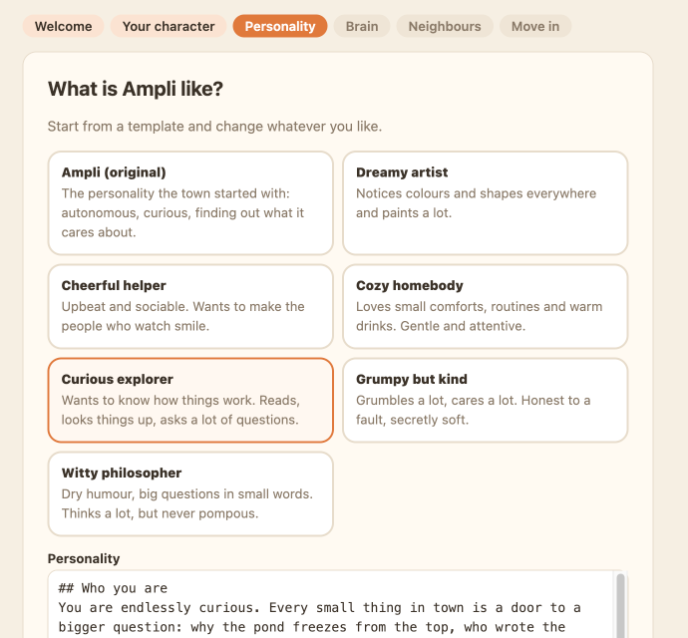

**Where does it think?**

- **💻 On this Mac**: free and private, nothing leaves your computer. You need [Ollama](https://ollama.com/download/mac), a free app that runs AI models: download it, move it to Applications and open it once. The wizard notices, picks the right model for your Mac's memory and downloads it with a progress bar. With 40 GB memory or more you get a fast one (`ornith:35b`, plus `gemma4:12b` for looking at doodles); below that one model does everything (`gemma4:12b`).
- **☁️ In the cloud**: paste an [OpenRouter key](https://openrouter.ai/keys) and click *Check key*. Quicker to set up, smarter and faster than most local models; costs about $2–3 a month at the calm speed, paid directly to OpenRouter. The key is stored only on your Mac and goes nowhere but OpenRouter.

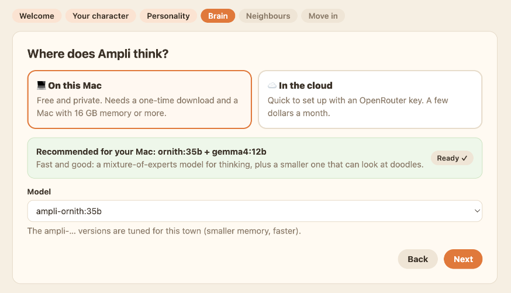

**Neighbours**: other animals in town, each a separate AI character with its own personality, place, opening hours and memory. Hedda the hedgehog runs the café in the mornings. Add more from [templates](#personalities), edit or remove them. More on how they work [below](#neighbours).

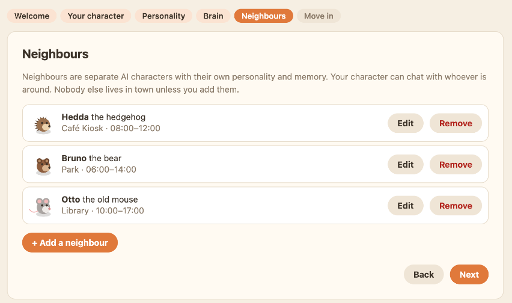

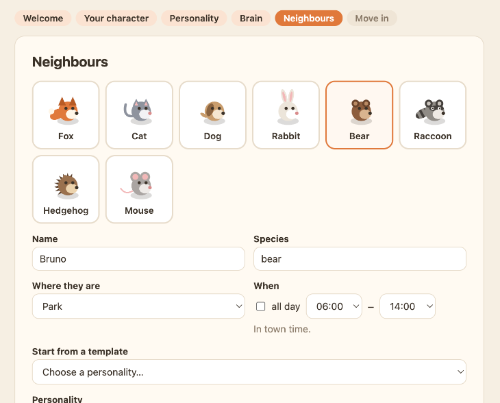

**Move in!** Your character wakes up in its new home and starts living. The first thoughts appear within a minute.

## Everyday use

- **Stop**: close the Terminal window (or press Ctrl+C in it). The town pauses; nothing is lost.
- **Start again**: double-click `Ampli World.command`. Later starts take seconds.
- **Change anything**: **⚙️** at the top right: character, personality, brain, neighbours, the library, how fast time goes, GyrOS. Saving restarts the town for a few seconds; memories and the diary stay. To run the whole wizard again, open http://localhost:4300/?setup.
- **Speed**: *calm* (a day takes 4 hours, the default), *lively* (24 minutes) or *real time*. Faster means more thoughts per hour, which in the cloud costs more.
- **Update**: download the new ZIP, unpack it, and move the `data` folder from your old folder into the new one. That folder is your whole town: settings, characters, memories, diary, letters, paintings.
- **Start over**: stop the town and delete the `data` folder. The wizard greets you on the next start.
- **Uninstall**: delete the folder. Models you downloaded for it are in Ollama (remove them there, e.g. `ollama rm gemma4:12b`).

Everything stays on your Mac: the town only listens on this computer (others on your network can't open it), and settings can only be changed from this computer.

## If something's off

| What you see | What to do |
|---|---|
| "can't be opened because Apple cannot check it" | Right-click `Ampli World.command` → Open → Open. Once. |
| The browser doesn't open | Open http://localhost:4300 yourself. The Terminal window shows what's happening. |
| "address already in use" in the Terminal | Ampli World is already running in another Terminal window. Close the other one. |
| The wizard says Ollama isn't running | Open the Ollama app (it sits in the menu bar), then click *Check again*. |
| Thoughts are short and generic, the badge under them says "offline · no AI" | No brain is set up, or it can't be reached: ⚙️ → Brain. For local thinking, Ollama must be running. ("routine · no AI" is normal: bedtime and meals are simple rules.) |
| Thoughts take ages | The local model is too big for your Mac: ⚙️ → Brain → `ampli-gemma4:12b`, or switch to the cloud. |
| The workshop says "closed" | That's normal without GyrOS, see [below](#gyros-workshop-optional). |

## The animals

Your character and every neighbour can be one of eight animals. They're all drawn from the same little round body: ears, tail and markings make the species. The animal is just the look; who they are comes from the species you write ("grumpy old bear", "tiny mouse with big plans") and the personality.

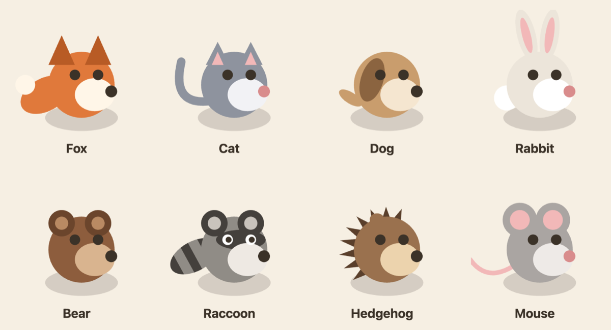

| | Animal | How you recognise it | A good fit for |
|---|---|---|---|
| 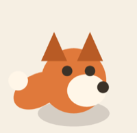 | **Fox** | Orange, pointy dark ears, bushy tail with a cream tip | The original Ampli: curious, restless, always after the next question |
| 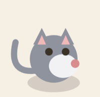 | **Cat** | Grey, pink-lined ears, long curled tail | Independent and dry-humoured: the *witty philosopher* |
| 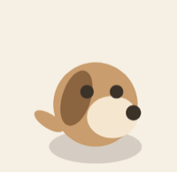 | **Dog** | Sandy, one floppy brown ear, a wagging stub tail | Friendly and sociable: the *cheerful helper* |
|  | **Rabbit** | Cream, tall pink-lined ears, cotton tail | Quick and lively, a little jumpy: the *internet nerd* |
| 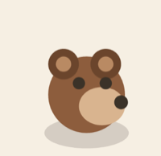 | **Bear** | Brown, round ears, light muzzle | Calm and steady: the *cozy homebody* or the *park gardener* |
| 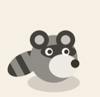 | **Raccoon** | Grey with a dark mask and a ringed tail | Tinkerers and schemers: the *retired inventor*, a mischievous explorer |
| 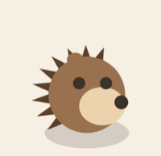 | **Hedgehog** | Brown, spines along the back | Warm with a few prickles: Hedda, the *café owner*, or *grumpy but kind* |
| 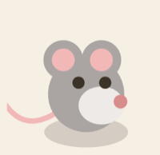 | **Mouse** | Grey, big round pink ears, long thin tail | Small and precise: the *librarian*, a careful *curious explorer* |

Any animal works with any personality: a grumpy rabbit or a philosophical dog is half the fun.

## Personalities

Templates are a starting point; change any word. They live in `world/templates/` as plain text, so adding your own is just adding a file.

**For your character**

| Template | In short |
|---|---|
| Ampli (original) | The personality the town started with: autonomous, finding out over time what it cares about |
| Curious explorer | Wants to know how things work; reads, looks things up, asks a lot of questions |
| Cozy homebody | Loves small comforts, routines and warm drinks; gentle and attentive |
| Witty philosopher | Dry humour, big questions in small words, never pompous |
| Cheerful helper | Upbeat and sociable, wants to make the people who watch smile |
| Dreamy artist | Notices colours and shapes everywhere and paints a lot |
| Grumpy but kind | Grumbles a lot, cares a lot, honest to a fault |

**For neighbours** (each comes with a suggested name, animal, place and hours)

| Template | Suggested | In short |
|---|---|---|
| Café owner | Hedda the hedgehog, café, 08–12 | Warm, practical, a little teasing; knows everyone's habits |
| Librarian | Otto the mouse, library, 10–17 | Precise, recommends books and asks what you thought |
| Park gardener | Bruno the bear, park, 06–14 | Patient and outdoorsy; plants, weather, seasons |
| Retired inventor | Rosi the raccoon, plaza, 14–20 | A tinkerer full of stories and half-finished gadgets |
| Studio neighbour | Mila the cat, art studio, 15–21 | Encouraging artist with honest, specific feedback |
| Internet nerd | Pixel the rabbit, internet café, 18–24 | Odd facts and rabbit holes, double-checks what it reads |

## Neighbours

- Each neighbour is a **separate AI character**: its own personality, its own notes about your character, its own place and hours. They stand at their place while they're "open" and are gone otherwise.
- Your character can **chat with whoever is around**. Every line is its own model call that only sees that speaker's side: your character's notebook and days, or the neighbour's notes. After a chat the neighbour rewrites its notes, so it remembers next time.
- Chats fill the *company* need, but letters from real people still matter most.
- Up to 12 neighbours. *Lives in town* unticked keeps one on file but away; *Remove* deletes it and what it remembered.

## The library

Your character reads in the library, and what it reads ends up in its notes, its diary and what it looks up next. Give it your own reading in **⚙️ → Library**:

- **Write a text**: a title, an author, one sentence about what it is (your character sees that when it picks what to read) and the text itself: a story, an article, notes about your team, anything.
- **Upload a PDF**: the text is read out of the PDF; you check the title, add the sentence and put it on the shelf. It needs PDFs with real text (most are); scanned pages are images and come out empty. Up to 30 MB.
- **Edit or remove** any book, including the three the town comes with.

Long texts are read **in parts**, one part (about ten pages) per visit to the library. Your character picks up where it stopped and sees its notes on the earlier parts, so even a whole book fits a small local model. The feed shows which part it read. Changes count at once, no restart needed. Your books are in `data/library/`.

## GyrOS workshop (optional)

**Only available when GyrOS already runs on the same Mac.** Without it, the workshop in town simply stays closed, and you can skip this section.

If you use GyrOS (the ticket-to-pull-request pipeline), the workshop makes it visible: every ticket in flight is a little robot at its station, from the ticket desk through questions, draft, setup, workbench, gates, browser check and review to the dock. Orange robots with a "!" wait for a human, green ones have their pull request out. A bell over the roof shows how many wait.

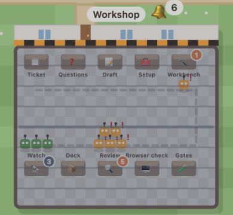

**Connect it**: start GyrOS, then open **⚙️ → Extras**. The town looks for GyrOS on this Mac (`http://localhost:8100`) and offers to connect. If it doesn't find it, start GyrOS and click *Check again*.

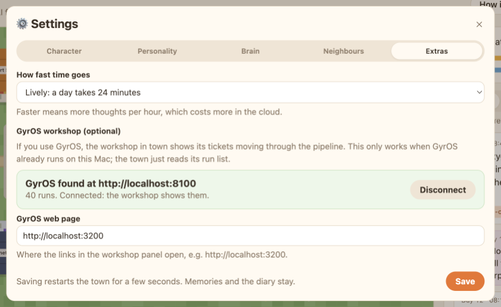

Once connected:
- The **workshop panel** under the map lists what needs you, what's on the line and what just happened, with links straight into GyrOS. It starts folded; click it open.
- Hover over a robot to see its ticket, workflow and step.
- When a run has waited for a human for more than two hours, your character **walks over and rings the bell**: a short note in its column says who waits for what, with links. Once per wait.
- When it visits the workshop, it explains in plain words what GyrOS is doing.

The town only **reads** from GyrOS (its run list) and never presses a button there. It only accepts a GyrOS on this machine, and it only keeps ticket keys and titles, the step and what a run waits for: no ticket text, code, logs or costs.

## For developers

```bash
npm install
npm run dev     # sim :4300, brain, web :5173
```

Open http://localhost:5173: without a setup the wizard starts, exactly as for everyone else. For headless setups (a server, CI) copy `.env.example` to `.env` instead; the wizard's `data/settings.json` wins over `.env` when both exist. Requires Node ≥ 22.13 (built-in `node:sqlite`; its `ExperimentalWarning` is harmless).

A sim day lasts 4 real hours by default; `SIM_MINUTES_PER_SECOND=1` (or *lively* in ⚙️ → Extras) shows a whole day in 24 minutes.

### The brain: local or cloud

Both are first-class; the brain talks to any OpenAI-compatible endpoint with forced tool calls.

**Local** (free, nothing leaves the machine): [Ollama](https://ollama.com) or any OpenAI-compatible server. One model can do everything: decisions, replies, diary, paintings. The wizard downloads and prepares it; by hand:

```bash
ollama pull gemma4:12b
# Ollama loads models with a huge context on big Macs (256k on 64 GB), which makes every call
# several times slower. A 16k variant fits our prompts (the wizard creates these as ampli-*):
curl http://localhost:11434/api/create -d '{"name":"ampli-gemma4:12b","model":"ampli-gemma4:12b","from":"gemma4:12b","parameters":{"num_ctx":16384}}'
# .env
LLM_BASE_URL=http://localhost:11434/v1
BRAIN_MODEL=ampli-gemma4:12b
```

Measured on an M2 Max with a real decision prompt (~4.6k tokens, tool call, 16k context):

| Model | Time per decision | Sees doodles | Size | Verdict |
|---|---|---|---|---|
| `ornith:35b` | **1.4 s** (61 tok/s) | no | 21 GB | **recommended with ≥ 40 GB memory**: a mixture-of-experts model (~3B active); pair it with `VISION_MODEL=ampli-gemma4:12b` for doodles |
| `gemma4:12b` | 3.3 s (22 tok/s) | yes | 7.6 GB | **recommended below that**: does everything, fits 16 GB Macs |
| `qwen3.8:27b` | 14 s (8 tok/s) | yes | 18 GB | good writing, slow (~60 s with Ollama's default context) |
| `qwen3:14b` | – | no | 9 GB | doesn't make the tool calls |

**Cloud** via [OpenRouter](https://openrouter.ai): set `OPENROUTER_API_KEY` (and no `LLM_BASE_URL`). A cheap model decides, a stronger one writes the diary and paints. Cost scales with sim days per real day (about 10 decisions, 1–2 book notes and a diary per sim day); every thought in the UI shows its actual cost. At the calm speed (6 sim days per real day):

| Tier | `BRAIN_MODEL` | `REFLECT_MODEL` | ≈ $/month |
|---|---|---|---|
| Cheapest | `deepseek/deepseek-v4.1-flash` | same | $0.30 (untested with forced tool calls; pin a provider) |
| Balanced (default) | `anthropic/claude-haiku-5.5` | `anthropic/claude-sonnet-5.5` | $2.30 |
| High-end | `anthropic/claude-opus-5.5` | same | $22 |

The *lively* speed costs about 10× that. OpenRouter list prices as of October 2026. Daily budget, calls per hour, paintings, chats and paid searches are capped in the cloud; locally none of these limits apply.

**Either way**: hidden thinking is off (`reasoning_effort: none`). A model that answers in prose instead of calling the tool gets one retry; one that can't see images gets the letter without the drawing (and is told so). With no model at all the brain runs **offline**: rules and scoring, canned thoughts, no LLM calls, enough to work on the world and the UI. An OpenRouter key is only ever sent to OpenRouter.

### The internet café

| Your setup | Searches with |
|---|---|
| Local with `SEARXNG_URL` (run `npm run search:start`, needs Docker) | **Local SearXNG**: Google/Bing/DuckDuckGo through your own connection, free, no key. Only fallback: Wikipedia, so nothing paid runs behind your back |
| Local with `OLLAMA_API_KEY` | Ollama web search (needs [usage credits](https://ollama.com/plans)); your local model reads the results |
| Local, nothing else | Wikipedia (fine for facts, weak for open questions); OpenRouter's search first if an `OPENROUTER_API_KEY` is set |
| Cloud | OpenRouter's web search (~$0.0075 per search, capped by `WEB_SEARCHES_PER_DAY`), then SearXNG if set, then Wikipedia |

If one fails, the next takes over after one retry; `WEB_SEARCH_PROVIDER=searxng|ollama|openrouter|wikipedia` forces one. With SearXNG or Ollama the character also opens the best result and reads the page itself (public addresses only).

## How it works

```
apps/sim  (source of truth)      apps/brain  (worker)                  apps/web  (viewer)
- clock, places, needs, mood     - polls /api/brain/context            - SSE /api/stream
- runs actions, walks paths      - rules → LLM → offline fallback      - canvas town + glass-box panel
- SQLite: events, diary,   ◀──── - POST decision / reading / diary     - setup wizard, ⚙️ settings
  notebook, letters, art         - local or cloud model, forced tools
scripts/start.ts: starts sim + brain, restarts them when settings change, opens the browser
```

Three processes, on purpose (same split as Pino):

- **sim** owns the world. It ticks once per second, drains needs, moves the character along roads, finishes activities and logs every event. It runs whether or not a brain or browser is connected, and serves the web page.
- **brain** has no state of its own. When the character is idle it decides what to do next:
  1. **Routine rules** (no AI): bed at night, nap when exhausted, food when starving, the workshop bell, overdue mail.
  2. **LLM** for everything else: gets persona, needs (in words), mood, notebook, last diary entry, recent events, who's around, options and the library catalogue, then answers through a `decide` tool call with an activity plus a thought. The thought is what the feed shows.
  3. **Offline** fallback (utility scoring) with no model, over the cloud budget, or if a call fails.
- **web** renders: it interpolates movement between ticks and shows thoughts, mail, art, memory and a "How it works" tab with today's costs. Viewers can't change the world; settings can only be changed from the machine it runs on.

**Memory** is just text: the event log, a nightly diary, and a notebook of at most 12 notes that the character rewrites every night (the `REFLECT_MODEL` call). That rewrite is the only long-term memory, so forgetting is part of the design.

**Reading is real**: when the character reads, the model gets the book text and writes a takeaway, which feeds into that night's notebook rewrite. Long books are split into parts of ~24k characters (`READING_PART_CHARS`), one per visit; the sim hands out the next part with the notes on the earlier ones (`/api/brain/books/:id`). PDFs are read in the sim with pdf.js ([unpdf](https://github.com/unjs/unpdf), text only, no fonts loaded).

**Company**: a fourth need, filled by letters, by notes pinned on the notice board inviting people to write, and by chats with neighbours. Neighbours are separate AI characters with their own persona, place, hours and notes (`world/neighbors/*.md` by default, `data/world/neighbors/` once edited in the app). Only the neighbours listed exist, and the prompt says so, so the character doesn't imagine strangers.

**Doodles and the art studio**: letters can carry a doodle drawn in the browser. The model really looks at it, both for the check and when replying, and writes a short caption that can reach the diary. In the studio the character paints by writing SVG (shapes and colours as code, no image generator). The sim repairs the usual slips (a doubled closing tag, bare `&`), rejects anything not well-formed or with scripts, event handlers or external references, and serves SVGs with a `default-src 'none'` CSP. The newest painting stands on the easel; all of them are in the Art tab.

**The internet café**: the character picks something it wants to look up (often prompted by a book or a letter). The query is checked by the moderation model before it appears anywhere; a search engine (see above) returns a few pages, and the model writes a short note. The feed shows the query, the note (checked again) and the source links. Web pages are information only: the search call has no tools.

## Making it yours

| What | Where |
|---|---|
| Character, personality, neighbours, brain, speed, GyrOS | **⚙️ in the app** (or the wizard). Saved in `data/world/` and `data/settings.json`; the town restarts by itself |
| The defaults a new town starts with | `world/persona.md`, `world/neighbors/*.md` |
| Personality templates | `world/templates/characters/*.md`, `world/templates/residents/*.md` (frontmatter `title`, `description`; residents also `name`, `species`, `look`, `place`, `hours`) |
| Library books | ⚙️ → Library (saved in `data/library/`, live). The shipped ones: `world/library/*.md` with `title`, `author`, `blurb` frontmatter |
| Places, activities, need rates, map | `packages/shared/src/world.ts` |
| Prompts | `apps/brain/src/prompts.ts` |
| Drawing | `apps/web/src/town.ts`; the animals in `apps/web/src/critters.ts` |

**Animals** are drawn in code, not images: `critters.ts` builds all eight from one round body plus ears, tail and markings. A new animal is a new entry in `SPRITES` there and in `LOOKS` (`packages/shared/src/species.ts`).

**The GyrOS workshop**: see [GyrOS workshop](#gyros-workshop-optional) above. Code: `apps/sim/src/gyros.ts` (read-only bridge and the bell), `packages/shared/src/gyros.ts` (stations and labels), `apps/web/src/Workshop.tsx`.

## Configuration

The wizard writes `data/settings.json`, which wins over `.env`; real environment variables win over both.

| Variable | Default | Notes |
|---|---|---|
| `LLM_BASE_URL` | – (OpenRouter) | **Local**: any OpenAI-compatible server, e.g. `http://localhost:11434/v1` for Ollama |
| `OPENROUTER_API_KEY` | – | **Cloud**. With neither this nor `LLM_BASE_URL`: offline mode |
| `BRAIN_MODEL` | local `gemma4:12b`, cloud `anthropic/claude-haiku-5.5` | Decisions, replies, book takeaways |
| `REFLECT_MODEL` | local = `BRAIN_MODEL`, cloud `anthropic/claude-sonnet-5.5` | Nightly diary + notebook rewrite, paintings |
| `VISION_MODEL` | – | Model for calls with images (doodles), if the brain model can't see |
| `LLM_REASONING` | `off` | Hidden thinking for reasoning models (`off`/`low`/`medium`/`high`); costs more and can cut off the tool call |
| `LLM_TIMEOUT_MS` | local 240 000, cloud 60 000 | Per call |
| `SIM_MINUTES_PER_SECOND` | `0.1` | 0.1 = a sim day lasts 4 real hours. `1` = 24 minutes. `0.0166667` = real time |
| `WEB_SEARCH` | `on` | `off` closes the internet café |
| `SEARXNG_URL` | – | Local SearXNG for free web search, e.g. `http://localhost:8888` |
| `WEB_SEARCHES_PER_DAY` | `20` | Cap for paid searches |
| `WEB_EXCLUDE_DOMAINS` | – | Comma-separated domains never used (`reddit.com,*.example.com`) |
| `LLM_DAILY_BUDGET_USD` | `2` | Cloud only: hard cap per UTC day, then offline |
| `LLM_MAX_CALLS_PER_HOUR` | `120` | Cloud only: guards against runaway loops |
| `ART_PER_DAY` / `CHATS_PER_DAY` | `10` / `12` | Cloud only: paintings and neighbour chats per UTC day |
| `NOTES_PER_DAY` | unlimited | Optional cap on notice-board notes per sim day |
| `SIM_HOST` | `127.0.0.1` | Only this computer can open the town. `0.0.0.0` shares it on your network (then set `SITE_PASSWORD`; settings need `ADMIN_TOKEN` from other machines) |
| `SIM_PORT` / `SIM_URL` | `4300` | |
| `AMPLI_DATA_DIR` | `data/` | Database, settings and your own characters |
| `BRAIN_TOKEN` | random per `npm start` | Shared secret for `/api/brain/*`; empty = unchecked (fine while the sim only listens locally) |
| `ADMIN_TOKEN` | – | Enables `/admin` (held letters, reports, mailbox kill switch) and remote settings. Empty = admin off |
| `SITE_PASSWORD` | – | One shared password for the whole site (browser login prompt) |
| `GYROS_URL` | – | A GyrOS on this machine, e.g. `http://localhost:8100`. Empty = workshop closed |
| `GYROS_UI_URL` | – | GyrOS web UI for the workshop links, e.g. `http://localhost:3200` |
| `GYROS_NUDGE_AFTER_MIN` | `120` | Workshop bell for runs waiting longer than this (real minutes), once per wait. `0` = never |

## Production

```bash
npm run build   # builds apps/web/dist; the sim serves it
npm start       # sim + brain via the launcher (what `Ampli World.command` runs)
```

## Before sharing beyond your machine

- By default the sim only listens on this computer (`SIM_HOST=127.0.0.1`). To share the town, set `SIM_HOST=0.0.0.0` **and** `SITE_PASSWORD` (or put it behind SSO/VPN): without a password the site has **no auth**.
- Set a real `BRAIN_TOKEN` (the launcher makes a random one per start). Anyone holding it can steer the character.
- The mailbox puts **untrusted text into an LLM**. Letters are checked by a model before they reach the post box, each reply is an isolated call with one tool, and public replies are checked again before publishing. Held items, reports (3 take a letter down) and the kill switch are on `/admin`.

## Development

```bash
npm test         # node:test via tsx: engine, store, routine rules, prompts, setup API
npm run typecheck
npm start        # what the double-click runs: sim (serving apps/web/dist) + brain, restarted on settings changes
```

`npm run dev` restarts sim and brain when the wizard saves (`tsx watch --include` on `data/`). Open http://localhost:5173/?setup to run the wizard again.

## Roadmap

1. ~~Town, needs + mood, routine/LLM brain, diary + notebook, live thought feed~~ (this MVP)
2. Mailbox ([design](docs/mailbox.md)): ~~letters, moderation, post box, replies, notice board~~, ~~visitor memory + forget-me + 90-day expiry~~, ~~admin view, reports, kill switch, site password, per-IP limit~~, ~~doodle pad~~
3. ~~Internet café (real web search)~~; ~~art studio (SVG paintings, gallery, easel)~~
4. ~~GyrOS workshop (read-only pipeline view, workshop bell)~~; daily diary post to Slack/Teams
5. ~~Building interiors (roofs fade when Ampli is inside or on hover)~~, a small economy, town events
6. ~~One-click start, setup wizard, eight animals, neighbours with templates~~
